# Iniciación a la Virtualización

DAW2

Daniel Roncero Guijarro

## Sumario

1. Instalación de Ubuntu en VirtualBox
2. Instalación de Docker en Ubuntu
3. Contenedores de servidor web y de aplicaciones
4. Comandos utilizados
5. Requerimientos mínimos para implantar una aplicación web
   - 5.1 Requisitos de hardware y software
   - 5.2 Infraestructura de red
   - 5.3 Configuración del servidor web y de aplicaciones
   - 5.4 Seguridad y mantenimiento
6. Conclusión

## 1. Instalación de Ubuntu en VirtualBox

Descargué la ISO de Ubuntu 24.04 LTS desde la página oficial y creé una máquina virtual nueva en VirtualBox con: 4096 MB de RAM, un disco virtual de 50 GB y red en modo NAT.

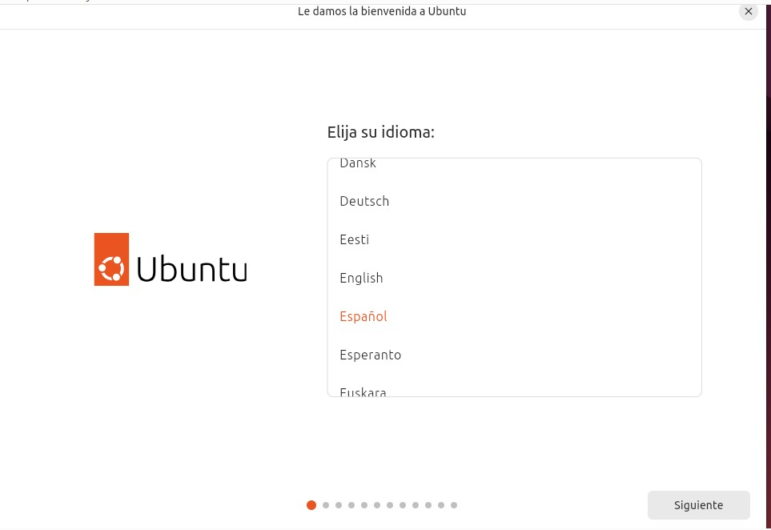

Elijo el español como idioma para toda la instalación.

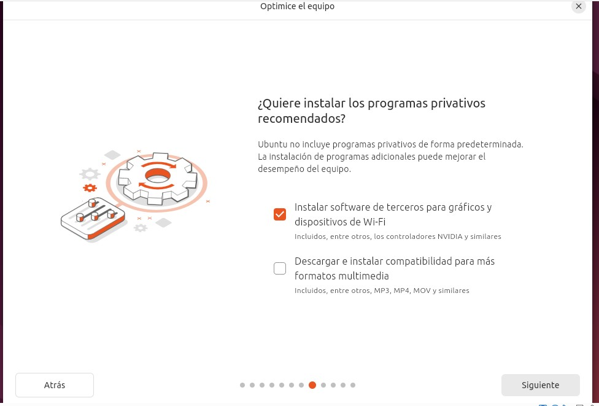

Marco la opción de instalar software de terceros para los gráficos y el Wi-Fi.

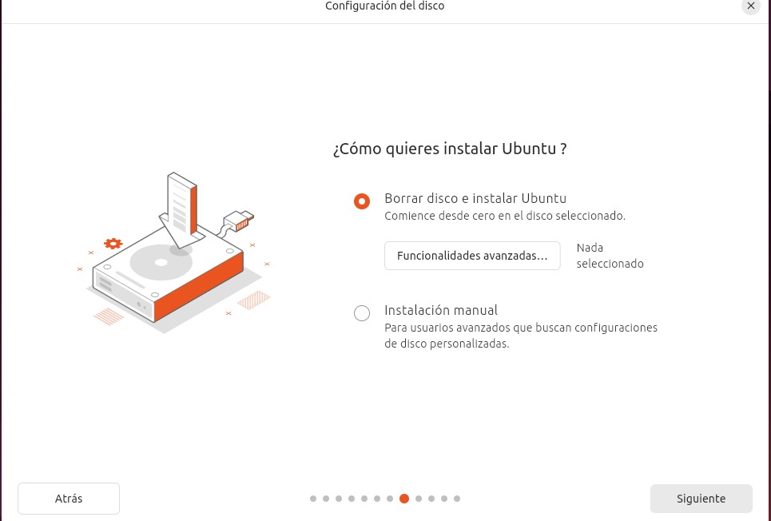

Escojo borrar el disco e instalar Ubuntu, ya que es el disco virtual de la máquina y está vacío.

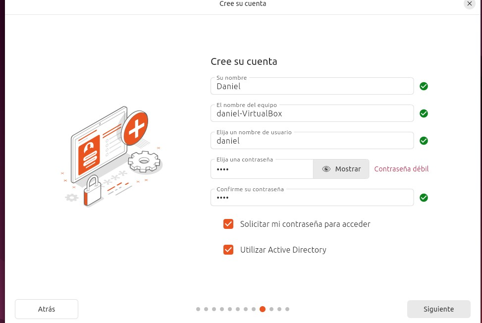

Creo mi usuario daniel y le pongo nombre al equipo, daniel-VirtualBox.

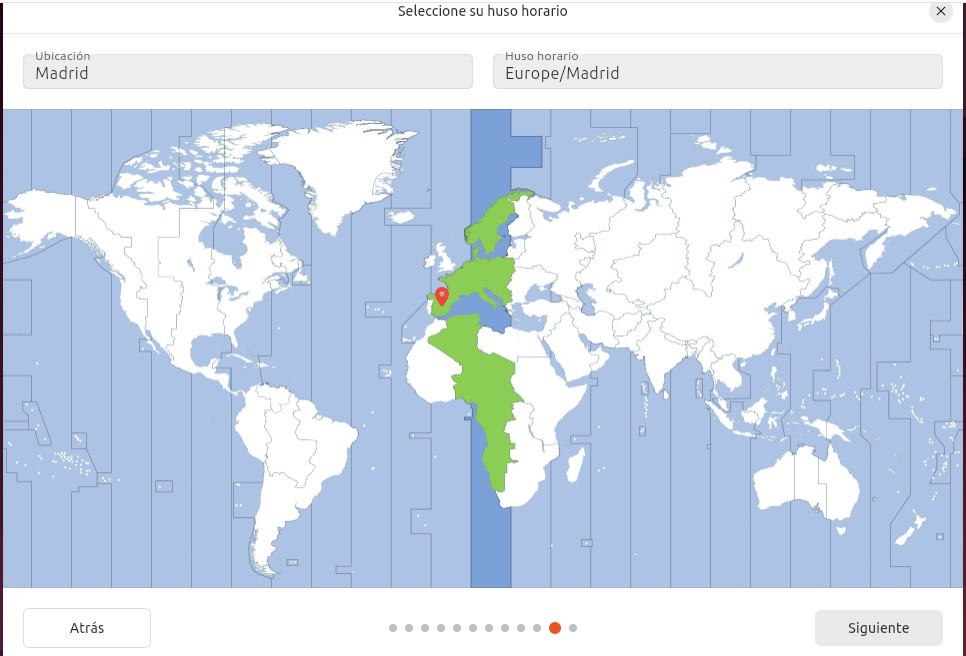

Selecciono Madrid como ubicación para que la zona horaria sea Europe/Madrid.

Una vez instalado el sistema instalé las Guest Additions desde el menú Dispositivos de VirtualBox. Solo hay que pulsar en Ejecutar programa y se instala todo de golpe, sin necesidad de reiniciar.

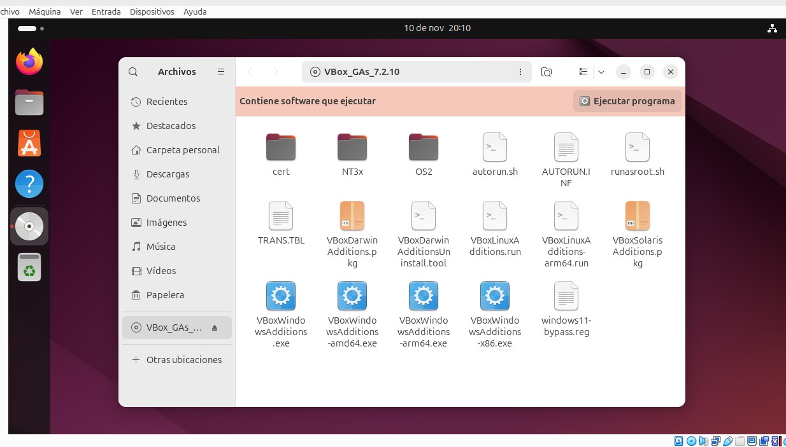

Abro el disco de las Guest Additions y pulso Ejecutar programa para instalarlas.

## 2. Instalación de Docker en Ubuntu

Un contenedor empaqueta el código de una aplicación junto con sus dependencias y su configuración. A diferencia de una máquina virtual, los contenedores comparten el kernel del sistema operativo, por eso son más ligeros y arrancan mucho más rápido.

Lo primero fue actualizar los repositorios e instalar las dependencias necesarias:

```
sudo apt update && sudo apt upgrade -y
sudo apt install ca-certificates curl gnupg -y
```

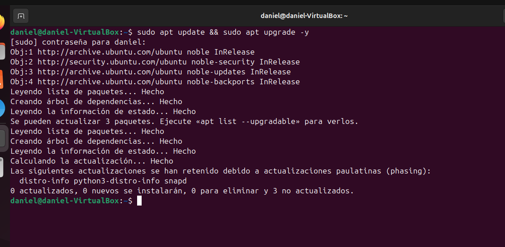

Actualizo la lista de paquetes y el sistema antes de instalar nada.

Después ejecuté el script de Docker, que añade el repositorio y instala Docker Engine:

```
curl -fsSL https://get.docker.com | sudo sh
sudo apt install docker-desktop -y
```

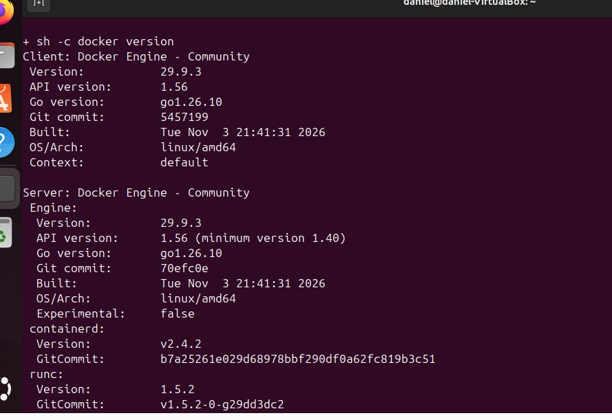

Al terminar el script se ve la versión instalada, Docker Engine 29.9.3, del cliente y del servidor.

Para comprobar que Docker funcionaba correctamente lancé el contenedor de prueba:

```
docker --version
docker run hello-world
```

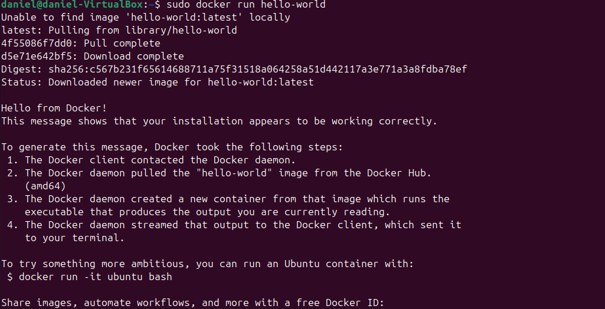

Ejecuto hello-world y Docker descarga la imagen y muestra el mensaje que confirma que todo funciona.

## 3. Contenedores de servidor web y de aplicaciones

Un servidor web lee las peticiones HTTP y HTTPS por ejemplo Nginx o Apache.
En esta parte monté un contenedor de cada tipo: Nginx como servidor web y Tomcat como servidor de aplicaciones.

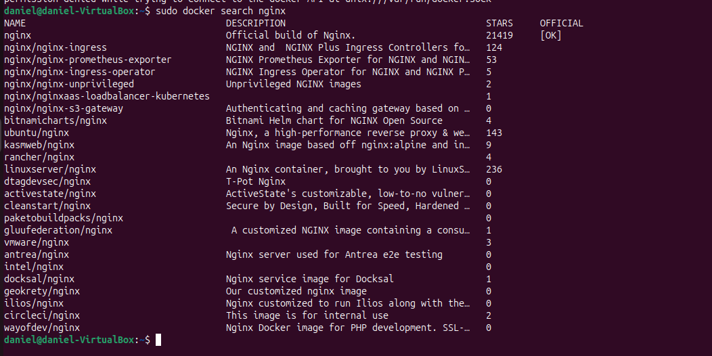

Busco en Docker Hub las imágenes de Nginx y veo que la primera es la oficial.

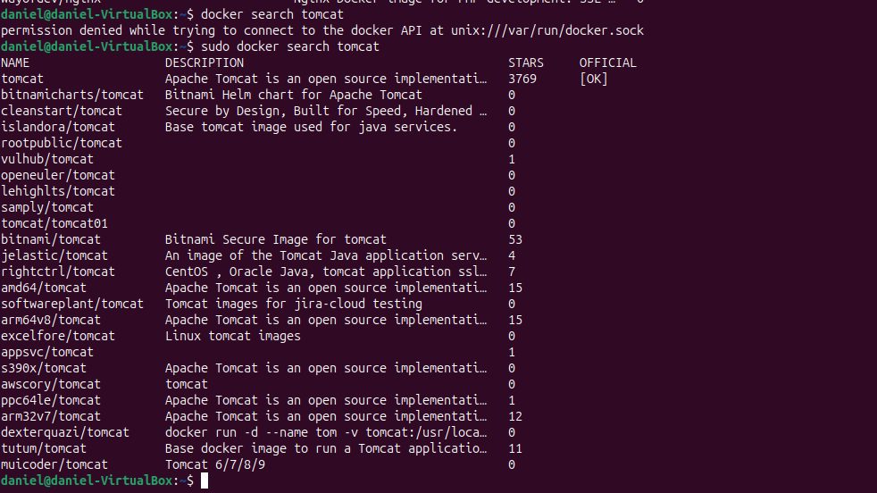

Busco la imagen de Tomcat; sin sudo me da error de permisos, así que lo repito con sudo.

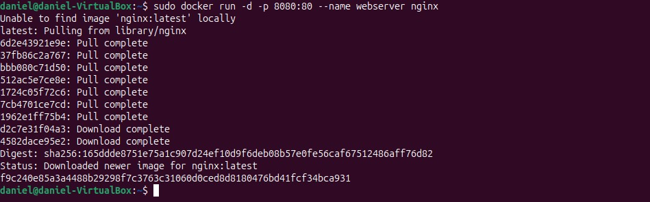

Descargo y arranco Nginx en segundo plano, con el puerto 8080 de mi máquina al 80 del contenedor.

Igual en la otra parte arranqué Tomcat con el nombre appserver, redirigiendo el puerto 8081 al 8080 del contenedor, y comprobé que los dos contenedores estaban en marcha:

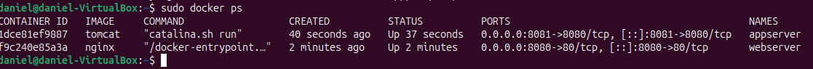

Con `docker ps` veo que appserver y webserver están activos y con sus puertos asignados.

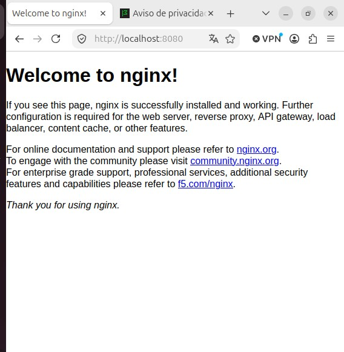

Entro en localhost:8080 y aparece la página de bienvenida de Nginx, así que el servidor web funciona.

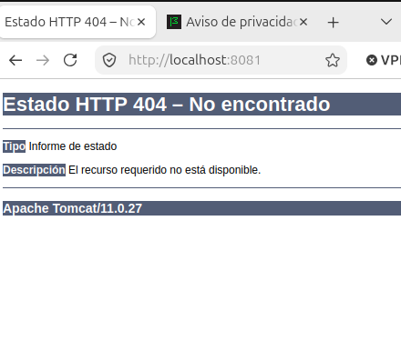

Entro en localhost:8081 da un 404 porque la imagen oficial trae la carpeta webapps vacía, pero el servidor está funcionando.

Para que Tomcat muestre su página de inicio basta tengo que poner esto pero no lo puse.

```
sudo docker exec appserver sh -c "cp -r webapps.dist/* webapps/"
```

## 4. Comandos utilizados

| Comando | Para qué sirve |
|---|---|
| sudo apt update && sudo apt upgrade -y | Actualiza los repositorios y el sistema |
| sudo apt install ca-certificates curl gnupg -y | Instala las dependencias previas |
| curl -fsSL https://get.docker.com \| sudo sh | Instala Docker con el script oficial |
| docker --version | Muestra la versión de Docker |
| docker run hello-world | Lanza el contenedor de prueba |
| docker search nginx | Busca imágenes de Nginx en Docker Hub |
| docker search tomcat | Busca imágenes de Tomcat en Docker Hub |
| docker run -d -p 8080:80 --name webserver nginx | Crea y arranca el contenedor de Nginx |
| docker run -d -p 8081:8080 --name appserver tomcat | Crea y arranca el contenedor de Tomcat |
| docker ps | Lista los contenedores activos |

Los comandos de Docker los ejecuto con sudo porque creo que lo tengo que meter en algún grupo y no lo metí el usuario.

## 5. Requerimientos mínimos para implantar una aplicación web

### 5.1 Requisitos de hardware y software

- Hardware: un procesador de 2 núcleos, 4 GB de RAM y unos 50GB mínimo
- Software: un sistema operativo Linux.

### 5.2 Infraestructura de red

- IP fija: el servidor necesita una IP fija para que siempre se le encuentre en la misma dirección.
- Dominio y DNS: para entrar con un nombre en lugar de con la IP hace falta registrar un dominio y apuntarlo al servidor.
- Puertos: solo deben estar abiertos los puertos necesarios: 80 para HTTP, 443 para HTTPS y 22 para SSH si se administra en remoto.

### 5.3 Configuración del servidor web y de aplicaciones

- Servidor web: el servidor web recibe las peticiones de los usuarios
- Servidor de aplicaciones: ejecuta la aplicación y se comunica con la base de datos.
- Contenedores: con Docker cada servicio va en su propio contenedor y se exponen los puertos con la opción `-p`, como hice con Nginx en el 8080 y Tomcat en el 8081

### 5.4 Seguridad y mantenimiento

- Cifrado: usar HTTPS con un certificado SSL
- Usuarios y accesos: no trabajar con el usuario root nunca trabajar con root y poner siempre las contraseñas cifradas porque si no el que maneja la base de datos puede ver las contraseñas cuando no las tiene que ver.
- Actualizaciones: actualizar el sistema, el servidor web, el de aplicaciones y las imágenes de Docker
- Copias y monitorización: hacer copias de seguridad periódicas de la aplicación y de la base de datos, y revisar los registros con comandos como `docker logs`.

## 6. Conclusión

Con esta práctica he aprendido a montar una máquina virtual con Ubuntu en VirtualBox, a instalar Docker y a desplegar en pocos minutos un servidor web y un servidor de aplicaciones en contenedores
